# Free-model benchmark: a voxel pagoda garden

Can the **free models on [opencode](https://opencode.ai)** build a real, working 3D web page from one long prompt?
On 2026-10-11 I gave the same 5 KB spec to all 11 models that were priced at $0 and checked what came back in a real (headless) browser.
Then I fixed the failure modes and re-ran the failures, and finally tried **orchestrating** the models: one lead splits the job into modules, free models write them, the lead assembles and reviews.
Earlier (2026-10-05/06) the same prompt was run on **local models** on my own GPU and on three cheap **paid cloud models**; both sets are included, with a [token and cost comparison](#cost-and-token-comparison) of everything.

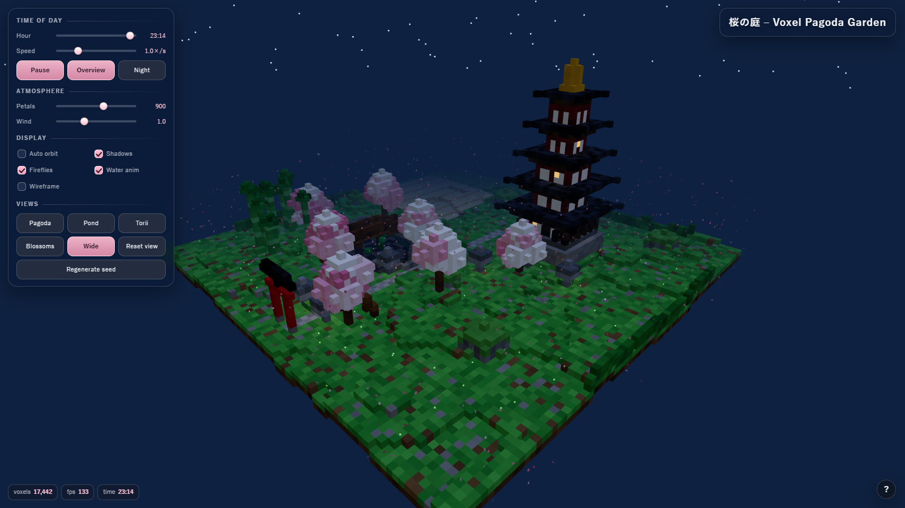

## The task

[`prompt/pagoda-prompt.txt`](prompt/pagoda-prompt.txt): a single self-contained HTML file with Three.js, a voxel engine (`InstancedMesh`, 15,000-18,000 voxels, seeded RNG), a five-tier pagoda, cherry trees,
a pond with koi and a bridge, a torii gate, lanterns, falling petals, fireflies, a day/night cycle with stars, orbit controls with camera presets, and a glass UI panel with ~15 controls.
Zero console errors allowed. It is a big prompt: roughly 12-15k tokens of correct code in one go.

Every page is scored by [`scripts/check_page.py`](scripts/check_page.py): load in headless Brave over the DevTools protocol, record console errors and exceptions, read the voxel count and UI, take day, pond and night screenshots, measure FPS.

## Local models (earlier runs, 2026-10-05)

The same prompt, run a week earlier on my own machine (AMD Radeon RX 7900 XT, 20 GB) against local servers instead of cloud models.
The main one is **Qwen3.8-Flash-Next Coder at IQ1_M** (a very aggressive quantisation), served locally as "Strata" on an OpenAI/Anthropic-compatible endpoint.
It was driven through two different agent harnesses (Claude Code CLI and opencode), plus one run of a larger **Qwen 3.8 27B (IQ4_XS)** on llama.cpp.
These runs used the plain prompt, without the "do not wait for approval" line that the cloud runs got.
Measured speeds, power draw and electricity cost per page are in [`results/local-speeds.json`](results/local-speeds.json), [`results/local-power.json`](results/local-power.json) and [`results/hardware-power-cost.json`](results/hardware-power-cost.json).
A second, test-scored local benchmark (six Python coding tasks with hidden tests, plus context sizes from 8K to 250K tokens) is in **[coding-bench/](coding-bench/REPORT.md)**.

| Run | Harness | Model | Time | Console errors | Voxels | FPS |
|---|---|---|---|---|---|---|
| Claude Code, run 1 | one shot | Flash-Next IQ1_M | 44m 07s (53 turns) | **0** | 16,500 | 133 |
| Claude Code, run 2 | one shot, rerun with the PC otherwise idle | Flash-Next IQ1_M | 20m 10s (61 turns) | 2, then **0** after a 2-line hand patch | 16,500 | 135 |
| Claude Code, guided | the spec fed in 5 stages by a script | Flash-Next IQ1_M | 63m 19s | **0** | 15,465 | 134 |
| opencode | one shot, provider `strata` | Flash-Next IQ1_M | 48m 41s | **0** | 16,350 | 145 |
| opencode, 27B | one shot, `--thinking`, 160K context | Qwen 3.8 27B IQ4_XS | 62m 33s | 2 (shader fails to compile) | 16,001 | 144 |

- **Run 2's two errors** were one mistake: it called `sun.target = sunTarget` with a `Vector3`, which crashes the shadow update. The hand patch is `scene.add(sun.target); sun.target.position.copy(sunTarget);`. Both versions are in [`pages/local/`](pages/local/).
- **The 27B's two errors** are one GLSL error (`'uInt' : undeclared identifier`). The failing shader leaves the pond as a dark pit; the rest of the garden renders. The model's own `status.md` says it could not do a real-browser check in its sandbox, which is exactly the check that would have caught it.
- **The opencode Flash-Next page** has 0 errors and the richest scene of the local set (trees, lanterns, bamboo, torii), but its title text renders as garbled characters.
- **The guided run** built the page in five stages (engine and ground; architecture; trees, pond, bamboo; light, time and particles; interface), checking each in a browser and sending the error back. It grew from 6,697 voxels / 9 KB after stage 1, to 10,594 after stage 2, to 15,461 after stage 3, to a finished 15,465 voxels / 58 KB.
  Stage 1 needed a fix (a `null` readout element); stage times were 288 s, 44 s (fix), 656 s, 1,097 s, 818 s and 896 s. Stage prompts are in [`local/guided-stages/`](local/guided-stages/).
- **Hardware load:** the two runs with GPU logs (run 2 and the 27B) held the GPU at about 95% activity on average, peaking at 83 °C hotspot, at about 275 W of GPU board power plus 70-110 W of CPU package power. Run 2 used about 129 Wh for its page, roughly 1.3-1.7 cents of electricity; details in [`results/local-power.json`](results/local-power.json).

<table>
<tr>
<td>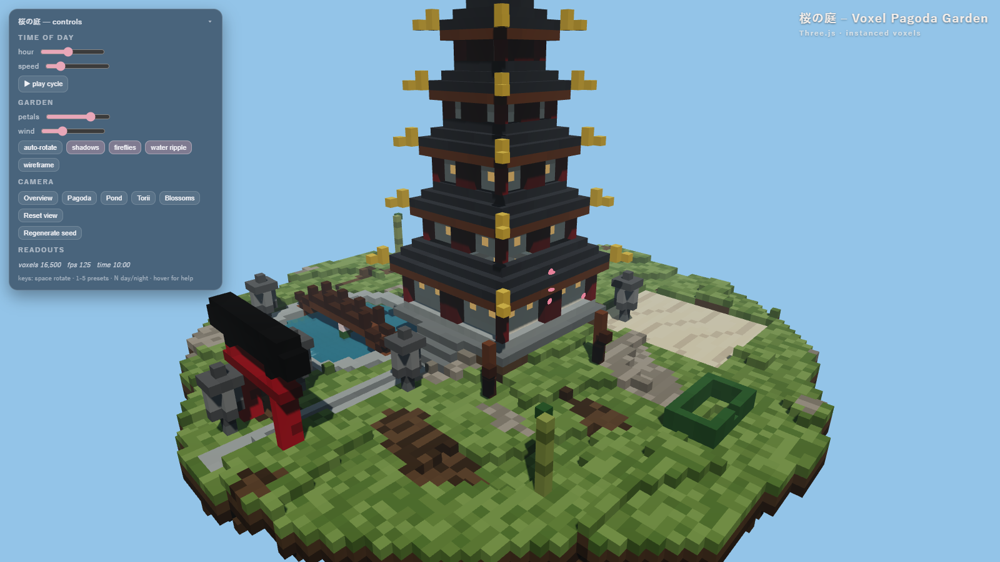<br>Claude Code, run 1</td>
<td>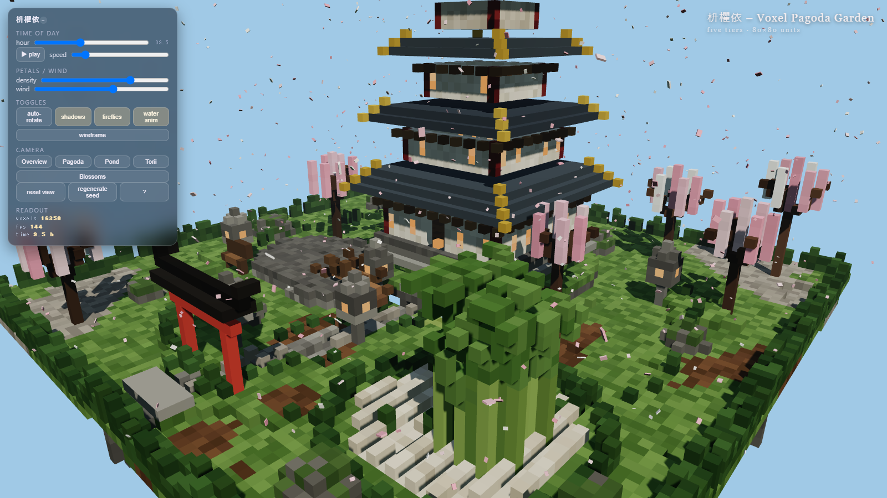<br>opencode, Flash-Next</td>
</tr>
<tr>
<td>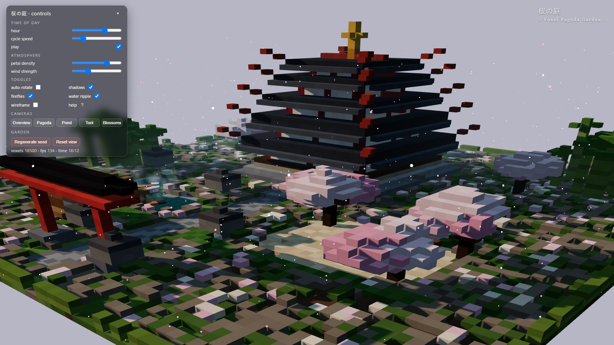<br>Claude Code, run 2 (hand-patched)</td>
<td>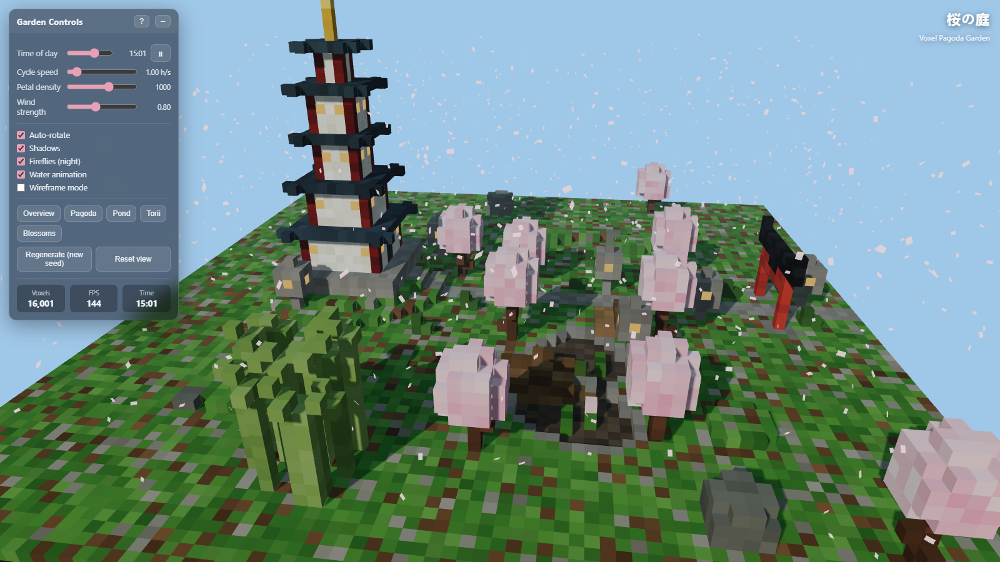<br>opencode, Qwen 3.8 27B (shader error)</td>
</tr>
</table>

My eyeball ranking of the local pages: run 1 looks best (a big, detailed pagoda with a pond, bridge, sand garden and torii); the opencode Flash-Next page has the busiest scene but the garbled title; run 2 is dark and busy but fine; the 27B's missing pond is the most visible defect.
Not a rubric. The local runs are a different era of this experiment, so they are shown for comparison, not ranked against the free cloud models.

## Results

### Pass 1: one shot, 11 free models

| Model | Time | Result |
|---|---|---|
| `muse-spark-1.3-contributor-free` | 3m 39s | **Works.** 0 errors, 17,231 voxels |
| `longcat-2.5-preview-free` | 18m 35s | **Works.** 0 errors, 15,395 voxels |
| `nemotron-3.5-lightning-free` | 20m 53s | Page has a JavaScript syntax error, never renders |
| `space-bunny-free` | 2m 19s | No page: spent 35k tokens thinking, wrote nothing |
| `big-pickle` | 3m 11s | No page: used its whole 32k reply limit on thinking |
| `mimo-v2.6-flash-free` | 14m 37s | No page: same, 32k tokens of thinking |
| `step-5-preview-free` | 23m 36s | No page: stream dropped (504 idle timeout) |
| `nemotron-3-ultra-free` | 15m 56s | No page: 504 idle timeout |
| `ling-3.1-flash-free` | - | Service rejected it (429 endpoint unavailable) |
| `ling-3.0-flash-fin-free` | - | Service rejected it (400 model unavailable) |
| `exo-free` | - | Deprecated (410) |

Pages: [`pages/solo/`](pages/solo/)

### Pass 2: fix the failure modes, re-run the failures

| Failure | Fix | Models |
|---|---|---|
| Thinking ate the reply limit | Prompt tells the model to build in parts (skeleton, then appended chunks) and not to draft code while thinking; `--variant low` where the model has a reasoning setting | `big-pickle`, `mimo`, `space-bunny`, `step-5` |
| 504 idle timeout / cut-off turn | Resume the same session (`opencode run -c`) with "inspect the file and continue" instead of starting over | `step-5`, `nemotron-3-ultra` |
| Syntax error | `node --check` on the module script; the exact error goes back to the model | `nemotron-3.5-lightning` |
| Runtime errors | After the browser check, console errors go back to the model once | all |

Harness: [`scripts/r4.py`](scripts/r4.py)

| Model | Before | After | Voxels | FPS |
|---|---|---|---|---|
| `ling-3.1-flash-free` | service rejected | **works** | 16,667 | 144 |
| `big-pickle` | no output | **works** | 16,264 | 144 |
| `mimo-v2.6-flash-free` | no output | **works** | 16,790 | 145 |
| `space-bunny-free` | no output | **works** | 16,229 | 144 |
| `step-5-preview-free` | 504 timeout | **works** | 16,500 | 145 |
| `nemotron-3-ultra-free` | 504 timeout | still broken: loads, no errors, never renders | - | - |
| `nemotron-3.5-lightning-free` | syntax error | still broken: requests a CDN file that 404s | - | - |
| `ling-3.0-flash-fin-free` | service rejected | still unavailable | - | - |

Five of the eight failures became working pages, all with 0 console errors. Pages: [`pages/rerun/`](pages/rerun/)

<table>
<tr>
<td>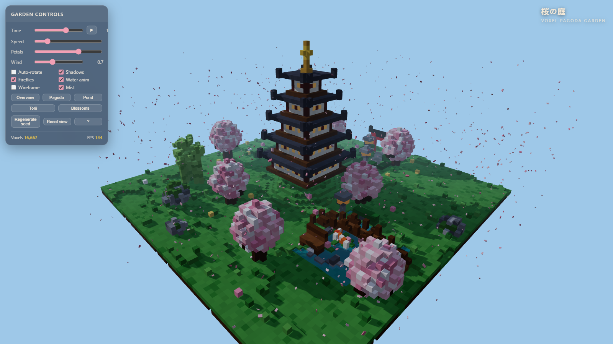<br><code>ling-3.1-flash</code></td>
<td>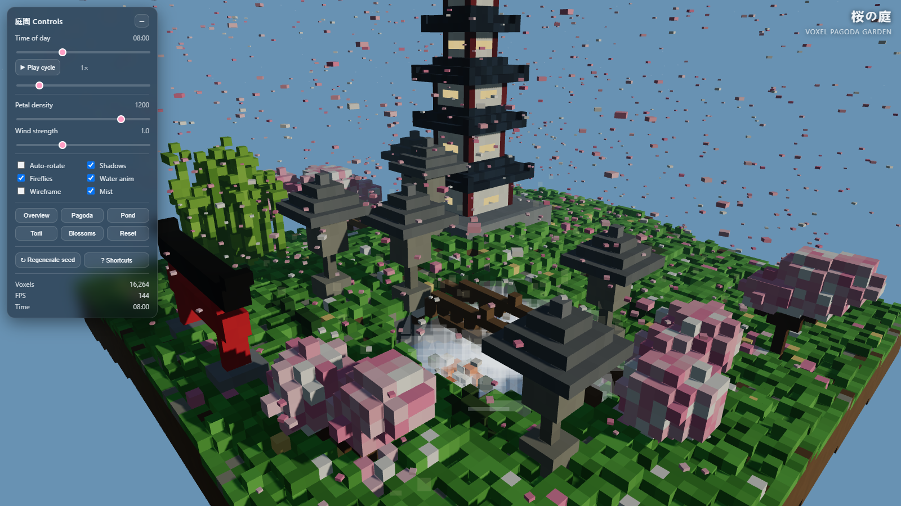<br><code>big-pickle</code></td>
</tr>
<tr>
<td>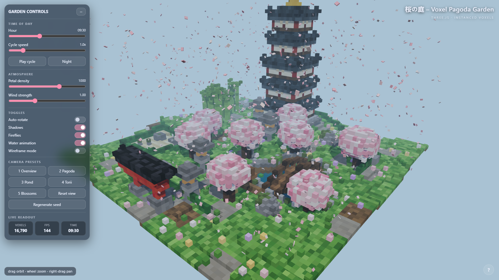<br><code>mimo-v2.6-flash</code></td>
<td>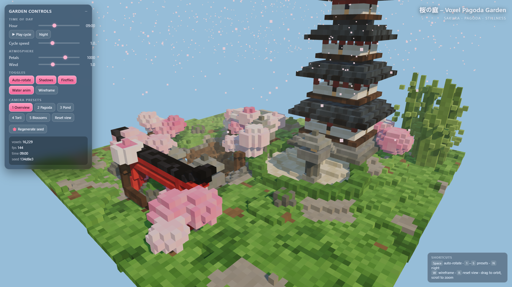<br><code>space-bunny</code></td>
</tr>
<tr>
<td>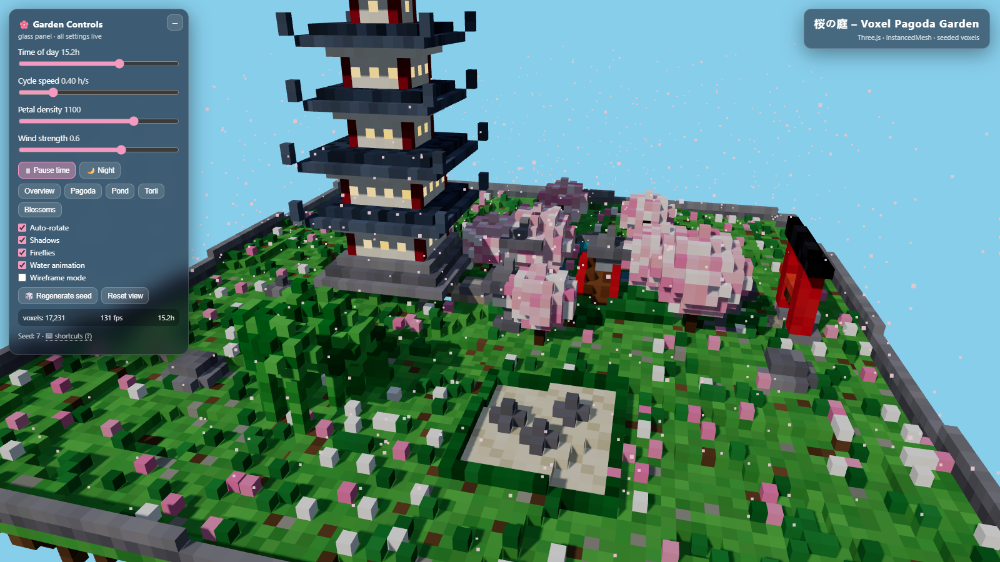<br><code>muse-spark-1.3</code> (solo, pass 1)</td>
<td>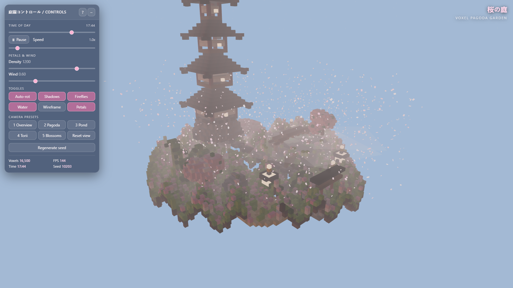<br><code>step-5-preview</code></td>
</tr>
</table>

My own eyeball ranking of the daytime shots, which is a judgement, not a rubric: `ling-3.1` and `big-pickle` look best (koi in the pond, lanterns, mist toggle), `mimo` and `muse` are close, `space-bunny` is decent but the camera crops the pagoda, `step-5` is washed out.

### Pass 3: orchestration

One lead model (Claude) wrote a [shared contract](orchestration/contract.md) (names, signatures, world layout, element ids) and five task briefs,
then sent each module to a free model **in parallel**, assembled the files with a small script, screenshotted the result and sent targeted fix briefs back.

| Module | Model | Time |
|---|---|---|
| core (voxel engine, RNG, terrain height) | `muse-spark-1.3` | 64 s |
| structures (pagoda, cherry trees) | `muse-spark-1.3` | 110 s |
| world (terrain, pond, torii, lanterns, bamboo, rocks) | `longcat` failed, retried on `muse-spark-1.3` | 720 s, then 119 s |
| runtime (renderer, lights, day/night, particles, api) | `longcat-2.5` | 452 s |
| ui (panel, bindings, shortcuts) | `space-bunny` | 39 s |

The first assembly loaded with **0 console errors and 17,442 voxels**. Two review rounds (about 45 s of model time in total) fixed a camera that sat inside the bamboo grove,
a night scene that was almost black, and missing stars.

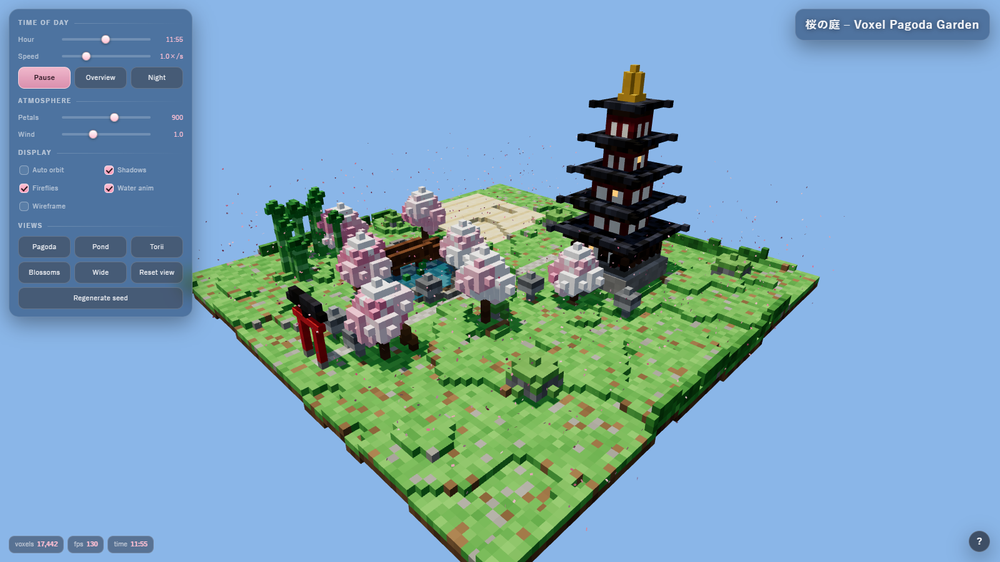
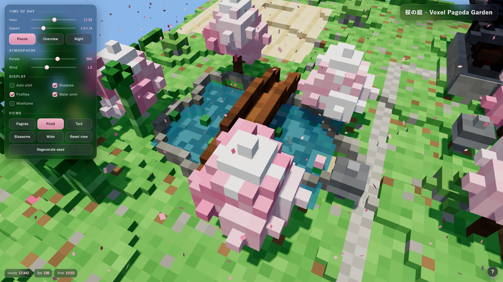

Final page: [`pages/orchestrated/index.html`](pages/orchestrated/index.html), 17,442 voxels, ~132 FPS headless. Briefs, fix briefs and the modules as delivered are in [`orchestration/`](orchestration/).
The first camera bug was my own contract's fault: it gave the bamboo's position but no keep-out zone, so two presets landed inside it.

## Paid cloud models (reference, 2026-10-05/06)

The same prompt on three cheap paid models through opencode's `opencode-go` provider, with the same lean agent config as the free runs
([`scripts/opencode-pagoda-config.json`](scripts/opencode-pagoda-config.json): file and shell tools, a handful of skills, no web).

| Run | Prompt | Time | Result | Cost |
|---|---|---|---|---|
| GPT-6 Luna #1 | plain | 4m 43s | works, 0 errors, but **19,978 voxels** (spec: 15,000-18,000) | $0.024 |
| GPT-6 Luna #2 | plain | 22 s | no page: stopped after a design note and a to-do list, waiting for approval that never comes | $0.003 |
| GPT-6 Luna #3 | + "do not wait for approval", 64k reply cap | 7m 17s | **works, 0 errors, 16,902 voxels** | $0.043 |
| GLM 5.3 Flash | plain | 15 min cap | no page: timed out without finishing a single step (not metered) | n/a |
| DeepSeek V4.1 Flash | plain | 16m 39s | **works, 0 errors, 16,521 voxels** | $0.095 |

Luna #2 is why the free runs got the "do not wait for approval" line. Pages: [`pages/paid/`](pages/paid/).

<table>
<tr>
<td>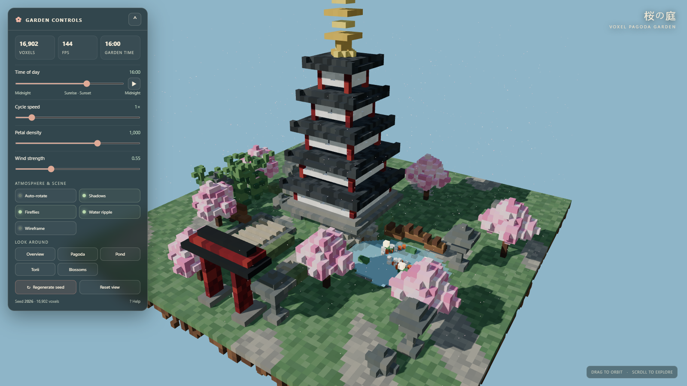<br>GPT-6 Luna #3</td>
<td>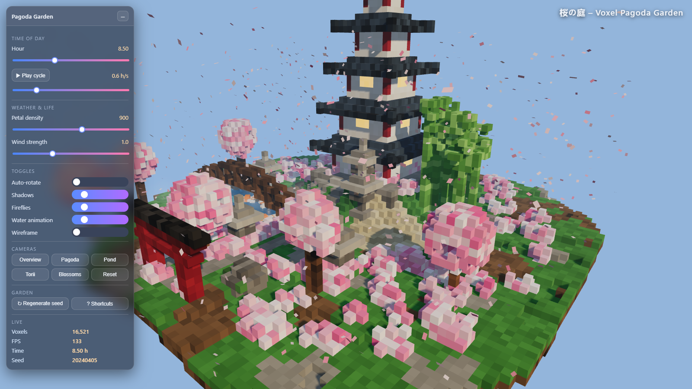<br>DeepSeek V4.1 Flash</td>
</tr>
</table>

By eye, Luna #3 and DeepSeek V4.1 Flash are the two best-looking pages of the whole experiment (tall pagoda with a finial, torii, koi in the pond, lanterns, lush blossom trees).
Luna #1 is moodier and busier, but over the voxel budget. This is the one place where paying clearly bought quality; the next section shows it cost cents.

## Cost and token comparison

Every run, with tokens totalled from the saved streams ([`scripts/token_table.py`](scripts/token_table.py), data in [`results/token-cost-table.json`](results/token-cost-table.json)).
Only runs that produced a page that renders are listed; failures are discussed below the table.

- **Input** is uncached input; **cache read** is context re-read from the prompt cache on later steps (agents re-send everything each step); **output + thinking** is what the model generated.
- **Reported cost** is opencode's own list-price estimate. Free models report $0.
  `$0*` for local runs means zero marginal cost, but the GPU ran at ~95% for the whole 20-63 minutes and I did not measure electricity.
- **Same tokens at Luna prices** is hypothetical: the run's tokens priced at GPT-6 Luna's list rates ($0.10 in / $0.50 out / $0.01 cache read / $0.125 cache write per 1M).
  It exists only to put free, local and paid runs on one price scale; it reproduces opencode's reported cost for the Luna runs exactly.

| Group | Run | Time | Input | Cache read | Output + thinking | Reported cost | Same tokens at Luna prices | Errors | Voxels |
|---|---|---|---|---|---|---|---|---|---|
| Paid cloud | gpt-6-luna #1 | 4m 43s | 60 | 549k | 26k | $0.024 | $0.024 | 0 | 19,978 |
| Paid cloud | gpt-6-luna #3 | 7m 17s | 99 | 1.55M | 39k | $0.043 | $0.043 | 0 | 16,902 |
| Paid cloud | deepseek-v4.1-flash | 16m 39s | 196k | 4.43M | 88k | $0.095 | $0.108 | 0 | 16,521 |
| Free cloud, one shot | muse-spark-1.3 | 3m 39s | 12k | 321k | 24k | $0 | $0.016 | 0 | 17,231 |
| Free cloud, one shot | longcat-2.5 | 18m 35s | 67k | 489k | 50k | $0 | $0.037 | 0 | 15,395 |
| Free cloud, re-run | ling-3.1-flash | 27m 46s | 551k | 2.23M | 72k | $0 | $0.113 | 0 | 16,667 |
| Free cloud, re-run | big-pickle | 5m 16s | 62k | 1.08M | 52k | $0 | $0.043 | 0 | 16,264 |
| Free cloud, re-run | mimo-v2.6-flash | 20m 03s | 97k | 1.68M | 60k | $0 | $0.056 | 0 | 16,790 |
| Free cloud, re-run | space-bunny | 4m 17s | 56k | 2.99M | 38k | $0 | $0.055 | 0 | 16,229 |
| Free cloud, re-run | step-5-preview | 29m 34s | 93k | 3.28M | 69k | $0 | $0.077 | 0 | 16,500 |
| Orchestrated (free) | 5 modules + 4 fix rounds | - | 140k | 545k | 107k | $0 | $0.073 | 0 | 17,442 |
| Local | claude-code run 1 | 44m 07s | 103k | 4.72M | 73k | $0* | $0.094 | 0 | 16,500 |
| Local | claude-code run 2 | 20m 10s | 79k | 4.72M | 74k | $0* | $0.092 | 2 | 16,500 |
| Local | claude-code guided (5 stages) | 63m 19s | 231k | 9.90M | 234k | $0* | $0.239 | 0 | 15,465 |
| Local | opencode | 48m 41s | 70k | 16.60M | 129k | $0* | $0.238 | 0 | 16,350 |
| Local | opencode 27B | 62m 33s | n/a | n/a | n/a | $0* | n/a | 2 | 16,001 |

Reading it:

- **Everything is cents.** The three paid pages cost $0.165 in total ($0.024, $0.043, $0.095), plus $0.003 for the stalled Luna run (GLM's timed-out run was not metered). At the same prices the free and local runs would have cost $0.016-$0.24 each.
  The paid advantage is quality and reliability, not that the free models are expensive in tokens.
- **Cache reads are roughly 70-99% of all tokens** (DeepSeek: 4.43M of 4.72M), so "tokens processed" headline numbers mostly measure how long an agent loop ran. **Output tokens** are the better measure of work: 24k-107k for the free and orchestrated pages, 26k-39k for Luna, 88k for DeepSeek, 73k-234k for the local runs.
- **The cheapest working page** was `muse-spark-1.3`: 24k output tokens, $0.016 at Luna prices, 3m 39s, 0 errors. The cheapest in-range *paid* page was Luna #3 at $0.043 and 7m 17s.
- **Failures cost tokens too.** The nine pass-1 runs that produced no working page burned 187k output tokens and 2.9M input+cache tokens, worth about $0.14 at Luna prices: more than any single paid page cost. (Free, so nobody paid, but that is the real price of trying free models: attempts, not dollars.)
- **The orchestrated build** used 107k output tokens across its five modules and four fix rounds, similar to a single hard run, and finished with what I judged the best page among the free models. Its tokens exclude the lead model's (Claude's) own, which were not metered here, so it is not a free lunch.
- **Claude Code's own cost field** said about $1.84-$1.88 for the local runs, because it prices local-model tokens as Anthropic's. Ignore it; the local cost is zero marginal dollars.
- **Local runs are slow because the model is tiny**: a 1-bit-class quantisation took 20-63 minutes versus 4-30 minutes for the working cloud runs. The 27B run's tokens were not recorded.

## DeepSeek-V4.1-Flash on one RX 7900 XT: the coding suite (2026-11-09)

The AtomicChat uncensored DeepSeek-V4.1-Flash at 1.75 bits per weight ran on Strata with an engine built here for
gfx1100. On the `coding-bench` suite (6 tasks, 1 rep, opencode's default prompt, 45-minute limit) it solved 4 of 6; T2
and T6 ran out of time. Decode was 3.1-4.2 tokens a second, so tasks took 9-28 minutes, against 1-7.5 minutes for
Qwen3.8-Flash-Next Coder on the same PC. With a "smallest change" prompt it solved 3 of 4 in 35% less time. The engine's
expert path on the graphics card produced NaN on long prompts, so every coding run kept all experts on the CPU. The
exact build, every number and the NaN search: [deepseek-v41-gfx1100/README.md](deepseek-v41-gfx1100/README.md).

## Takeaways

- With one big prompt, **2 of 11** free models delivered a working page. With a build-in-parts prompt and a repair loop, **7 of 11** did.
- The dominant failure was **thinking eating the reply limit** on models capped at 32k output tokens, not lack of ability: told to write the file in chunks, the same models produced clean pages.
- Orchestration made the most polished result from the weakest parts, and it was cheap: the whole thing ran on free models. The lead's job is mostly writing an unambiguous contract and looking at screenshots.
- **Local models can do it too, slowly.** A 1-bit-class quantisation of a small Qwen coder produced a clean 16,500-voxel page in 20-48 minutes on a single consumer GPU (three of the five local runs shipped with zero console errors). The cloud free models were faster (a working page in 2-4 minutes at best), but the local ones had no rate limits, no deprecations and no 504s.
- **Paid is better and cheap; free is competitive on cost but slower to trust.** The two best-looking pages (GPT-6 Luna #3, DeepSeek V4.1 Flash) cost $0.04-$0.10 each. The best free results (`muse`, the orchestrated build) are close on spec and price but needed more care, and many free runs failed outright.
- Free models are flaky as a service: 504s, 429s, a deprecated model, and one model that came back to life between passes. Results are one run per model.

## Caveats

- Costs are opencode's list-price estimates; actual billing depends on your plan (the `opencode-go` provider may be a flat subscription), and free models' real cost is the retries. One run per model per condition, and the local runs were on a different day, with a plain prompt and different harness settings from the cloud passes. Failures are not necessarily repeatable (`space-bunny` produced a page on an earlier date; the 504s are service-side).
- "Works" means: no console errors, a canvas renders, voxel count in range, controls present. I viewed the day screenshots for every working page and the pond and night shots only for the orchestrated build, so koi, mist, stars and the day/night cycle are unverified for the others. Keyboard shortcuts, *Regenerate seed* and wireframe were not exercised for any page.
- Passes 1 and 2 differ in prompt and harness on purpose (that is the point); pass 3 adds a lead model, so it is not a fair head-to-head with the solo runs.
- Model lists, prices and availability are from 2026-10-11.

## Layout

```
prompt/           the task prompt
pages/            every generated page (solo/, rerun/, orchestrated/, local/, paid/); *-BROKEN.html are kept for transparency
local/            the local-model runs: guided-stage prompts and screenshots, configs, the models' own status notes
screenshots/      day/pond/night shots of the working pages
results/          machine-readable tables and per-page browser-check output
scripts/          probe, batch runner, page checker, collectors, the pass-2 repair harness
orchestration/    contract, task and fix briefs, dispatcher, assembler, modules as delivered
coding-bench/     the local coding suite: tasks, hidden tests, scorer, harness, every run
deepseek-v41-gfx1100/  the DeepSeek-V4.1-Flash gfx1100 build, its speed tests and its coding-suite report
```

The scripts were written for one Windows machine (Git Bash, Brave, the `opencode` CLI, paths under `E:\strata-tests`); adjust the paths at the top to reuse them.
Paths in this copy are anonymised: the home folder reads `C:\Users\user`, so logs and scripts show that instead of the real path.
Pages load Three.js r160 from jsDelivr, so open them with a network connection.
