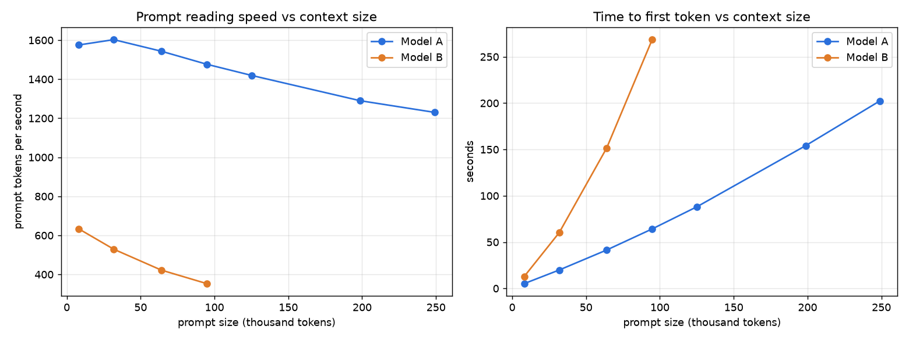

# Local coding benchmark: Qwen3.8-Flash-Next Coder (Strata) vs Qwen3.8-27B (llama.cpp)

Measured 2026-10-19/20 on one PC: AMD Radeon RX 7900 XT 20 GB, Ryzen 9 5900X, 64 GB DDR4, Windows 11.

**Short answer.**
- **Coding quality is about the same.** Both models solve almost everything:
  - Model A: 11 of 12 runs fully solved, mean hidden-test score 99.7%.
  - Model B: 10 of 12 runs fully solved, mean 97.0%. One of B's two misses was a mistyped path that ended its run.
- **Model A is much faster on long input.**
  - It reads prompts 2.5x (8K) to 4.2x (96K) faster.
  - It keeps its output speed at long context: 77 tok/s at 96K, where B drops to 47.5.
- **Model A goes further.** It answered every recall question correctly up to 250K tokens. Model B is limited to 98K on this desktop.
- **Energy is about the same** per coding run: about 19–20 Wh, about 0.2 cents of electricity.
- **Model B is lighter on the PC.** A pins about 29 GB of RAM; B fits on the GPU and leaves the RAM free.

| | Model A | Model B |
|---|---|---|
| Model | Qwen3.8-Flash-Next Coder IQ1_M (ISTA-DASLab's pruned coder MoE, 54 GB) | Qwen3.8-27B IQ4_XS (bartowski, 14.4 GiB) |
| Runtime | Strata 0.1.45, HIP, side by side with the installed 0.1.39 | llama.cpp b11748, Vulkan |
| Coding: runs fully solved | **11 / 12** | 10 / 12 |
| Coding: mean hidden-test score | **99.7%** | 97.0% |
| Coding: total time for 12 runs | **38.2 min** | 43.9 min |
| Coding: mean energy per run | **18.7 Wh** ($0.0019) | 19.8 Wh ($0.0021) |
| Prompt tok/s, 8K / 96K | **1,575 / 1,477** | 633 / 353 |
| Output tok/s, 8K / 96K | 80.3 / **77.0** | **81.1** / 47.5 |
| Time to first token at 96K | **64 s** | 269 s |
| Largest context used | **249K tokens**, 3/3 recall | 95K tokens, 3/3 recall (98K locked) |
| RAM held by the server | ~29 GB pinned | ~17–23 GB working set, mostly the memory-mapped model file |
| Load time (model files already in the disk cache) | ~22 s | ~11 s |

## 1. Final settings and what tuning gained

Full details, sources and rejected options are in [SETUP.md](SETUP.md); every tuning arm is in
[results/tuning.json](results/tuning.json).

Tuning was measured on a fixed 16,050-token prompt with 512 output tokens. Each setting got 1 warm-up and 3 timed
runs, with medians reported. Each repeat started with a unique line, so no cached prompt was reused.

### Model A: [configs/model-a.json](configs/model-a.json), started with [configs/model-a-start.ps1](configs/model-a-start.ps1)

Strata 0.1.45 (HIP) plus:
- the gfx1100 hipBLASLt table (`STRATA_HIPBLASLT_TUNING`)
- `--expert-cache auto` with `--vram-reserve-mib 1792`
- `--prefill auto:16384`
- `STRATA_PREFILL_CPU_SHARE=auto`
- `--kv int8 --kv-resident 32768`, `--spec 4 --spec-min-p 0.5`, `--max-context 262144`
- Qwen thinking sampling (temperature 1.0, top_p 0.95, top_k 20)
- a thinking budget of 8,192 tokens

| | Old default (installed engine 0.1.39) | Locked | Change |
|---|---|---|---|
| Time to first token, 16K prompt | 21.4 s | 9.96 s | −53% |
| Prompt tok/s | 754 | 1,621 | **2.15x** |
| Output tok/s | 67.8 | 68.2 | flat |

- **What "old default" means here:** the installed 0.1.39 engine with your config's engine arguments, plus the Phase 1
  base changes (`--vram-reserve-mib 1024`, Qwen thinking sampling, an 8,192-token thinking budget). It is not your
  exact original config.
- **The gain is almost all the hipBLASLt table.** 0.1.45 without it reads 739 tok/s, the same as 0.1.39.
- **Your installed Strata is unchanged.** 0.1.45 ran from a separate git worktree under `tools/`.
- **What it would take to get this speed in daily use:** updating Strata.

### Model B: [configs/model-b.json](configs/model-b.json), started with [configs/model-b-start.ps1](configs/model-b-start.ps1)

llama.cpp b11748 Vulkan with:
- `-c 98304`, q4_0 K and V cache, `-fa on`, `-b 2048 -ub 512`
- embedded MTP with `--spec-draft-n-max 3 --spec-draft-sampling probabilistic`
- Qwen thinking sampling and `--reasoning-budget 8192`

| | Old default (winget b10752, greedy MTP, same 98K context) | Locked | Change |
|---|---|---|---|
| Time to first token, 16K prompt | 33.0 s | 26.9 s | −18% |
| Prompt tok/s | 488 | 598 | **+23%** |
| Output tok/s | 53.7 | 65.5 | **+22%** |

**The old default no longer fits.** The earlier `run.ps1` used 163,840 context. Today other programs hold about 1.7 GB
of VRAM (0.9 GB in the earlier session), so that setting spilled 1.6 GB into system memory and read prompts at about
45 tok/s.

Rejected after measuring:

| Option | Result | Why rejected |
|---|---|---|
| ROCm builds (official, AMD Lemonade) | 795 prompt tok/s at 65K, about 33% faster than Vulkan | they need about 1.4 GB more VRAM and fall to 230–250 tok/s as soon as they spill |
| q8_0 KV | output 36.4 tok/s | slower |
| `-ub 2048` | spills | — |
| MTP n=2 | no gain | — |
| `GGML_VK_DISABLE_MMVQ` | output 50.1 tok/s | slower |
| n-gram drafting | output 39.9 tok/s | slower |
| BeeLlama | same speed as b11748 | 0.5 GB more VRAM |

### Correctness check

Each locked config passed a smoke test 3 times in a row. It covers:
- a tool call
- typed tool arguments
- using a tool result
- a short coding answer that is executed against asserts

## 2. The coding test

### What it is

- **The project:** `inventory-service`, a Python package of about 1,190 lines in 10 modules with 30 visible tests.
  It covers pricing rules, stock reservations, orders, refunds, CSV import/export, JSON storage and a CLI.
- **Six tasks**, each run twice per model through opencode 1.19.3:
  - The README was the only instruction, sent on stdin, ending with "Work autonomously; do not wait for approval."
  - Limits: 45 minutes and 150 steps per run.
  - opencode had only its 7 core tools: no MCP servers, skills or subagents.
- **Scoring** is by hidden tests the model never saw, run from a separate folder with their own config.
  - Each task has task-specific hidden tests plus 15–24 regression tests.
  - Task 6 (writing tests) is scored by 10 hand-written mutants of `reports.py`.
- **Validation:** before any model ran, every task-specific hidden test failed on the starting code and passed on the
  reference solution, and the Task 6 reference tests caught all 10 mutants ([VALIDATION.txt](VALIDATION.txt)).
- **Freeze:** all 131 task and hidden-test files are hashed in [FROZEN.txt](FROZEN.txt) and were re-checked before
  every run.

### Results per task

Each cell is the mean over 2 runs. Time and energy are medians.

| Task | A score | A time | A steps | A Wh | B score | B time | B steps | B Wh |
|---|---|---|---|---|---|---|---|---|
| T1 fix 3 planted bugs | 100% | 0.9 min | 10 | 4.5 | 100% | 2.0 min | 9.5 | 10.5 |
| T2 multi-currency feature | 100% | 7.5 min | 60 | 46.6 | 84% | 8.6 min | 29 | 48.5 |
| T3 refactor pricing.py | 98% | 1.5 min | 10.5 | 8.4 | 98% | 1.5 min | 6.5 | 8.1 |
| T4 implement from docstring | 100% | 1.3 min | 8 | 7.7 | 100% | 2.3 min | 14.5 | 12.0 |
| T5 bug from a user report | 100% | 1.4 min | 15.5 | 8.1 | 100% | 1.3 min | 11 | 7.1 |
| T6 write tests (mutation) | 100% (10/10) | 6.6 min | 20 | 37.0 | 100% (10/10) | 6.3 min | 18 | 32.8 |
| **All 12 runs** | **99.7%, 11 solved** | 38.2 min total | | 224.5 Wh | **97.0%, 10 solved** | 43.9 min total | | 237.9 Wh |

What the misses were:
- **T3, both models, first run (24/25).** Each refactor looked up an unknown SKU before checking the quantity. That
  changed the error message for an input with both an unknown SKU and quantity 0. The README requires identical
  errors, and both models got it right on their second run.
- **B T2, rep 2 (19/28).** After 10 steps Model B tried to edit `...\r2\r2\work\...`, a mistyped path outside its
  folder. In non-interactive mode opencode auto-rejects edits outside the project, which ended the session with the
  feature half done.
- **Running the tests:** every one of the 24 runs ran the visible tests itself.

Tokens per run (mean, from the saved streams):

| | Input | Cache-read | Output |
|---|---|---|---|
| A | 19,637 | 535,316 | 9,856 |
| B | 22,257 | 342,511 | 10,112 |

Both servers reported cache reuse (`cached_tokens`), so most of each turn's prompt came from the cache.

Every run, with tokens and energy, is in [results/coding.json](results/coding.json); the full table is in the
appendix.

### Electricity cost per task at $0.104/kWh

Energy here is GPU board power plus CPU package power over each run's wall time.

| Task | Model A | Model B |
|---|---|---|
| T1 | $0.0005 | $0.0011 |
| T2 | $0.0048 | $0.0050 |
| T3 | $0.0009 | $0.0008 |
| T4 | $0.0008 | $0.0013 |
| T5 | $0.0008 | $0.0007 |
| T6 | $0.0038 | $0.0034 |
| All six tasks once | ~$0.012 (112 Wh) | ~$0.012 (119 Wh) |

The whole benchmark, including tuning, used 1.38 kWh as logged, about $0.14.
- Phase 1 tuning: 550 Wh
- Phase 3 coding: 473 Wh
- Phase 4 context: 352 Wh

## 3. Context size: speed and recall

How it was run:
- **The prompt:** real `inventory_service` code plus generated modules in the same style.
- **Three planted facts at about 10%, 50% and 90% depth.** The third question asks for a one-line fix whose answer
  depends on a constant 80% of the prompt away. That fix line is executed to grade it.
- **The requests:** one streaming request per repeat, 3 repeats per size, each with a unique first line.
  - Output was capped at 4,096 tokens and thinking at 2,048.
- **Raw data:** [results/context.json](results/context.json).

### Model A (Strata, 262,144 max context)

| Prompt tokens | Time to first token | Prompt tok/s | Output tok/s | Peak VRAM | Server RAM | Correct | Wh |
|---|---|---|---|---|---|---|---|
| 8,186 | 5.2 s | 1,575 | 80.3 | 18.7 GB | 28.9 GB | 3,3,3 | 1.4 |
| 31,852 | 19.9 s | 1,603 | 76.7 | 18.7 GB | 29.0 GB | 3,3,3 | 3.1 |
| 63,968 | 41.4 s | 1,543 | 76.8 | 18.8 GB | 29.2 GB | 3,3,3 | 5.2 |
| 94,781 | 64.2 s | 1,477 | 77.0 | 18.8 GB | 29.4 GB | 3,3,3 | 7.6 |
| 125,207 | 88.2 s | 1,419 | 76.4 | 18.8 GB | 29.4 GB | 3,3,3 | 9.9 |
| 198,702 | 154.1 s | 1,290 | 73.8 | 18.8 GB | 29.5 GB | 3,3,3 | 16.7 |
| 248,957 | 202.4 s | 1,230 | 73.4 | 18.8 GB | 29.5 GB | 3,3,3 | 21.4 |

### Model B (llama.cpp, locked at 98,304 context)

| Prompt tokens | Time to first token | Prompt tok/s | Output tok/s | Peak VRAM | Server RAM | Correct | Wh |
|---|---|---|---|---|---|---|---|
| 8,188 | 12.9 s | 633 | 81.1 | 19.3 GB | 16.7 GB | 3,3,3 | 2.0 |
| 31,853 | 60.2 s | 529 | 67.8 | 19.5 GB | 19.7 GB | 3,3,3 | 6.9 |
| 63,968 | 151.5 s | 422 | 55.3 | 19.6 GB | 23.0 GB | 3,3,3 | 16.5 |
| 94,780 | 268.5 s | 353 | 47.5 | 19.7 GB | 23.3 GB | 3,3,3 | 26.7 |
| 125K / 199K / 249K | does not fit the locked 98,304 context (recorded, not sent) | | | | | | |

How to read the table:
- **VRAM** is the card's total dedicated memory in use, including the 1.7–2.4 GB that other programs held. It is not
  the model's own footprint.
- **Shared GPU memory (not shown):**
  - Model A: about 28.6 GB at every size. That is Strata's page-locked expert store in RAM, which it maps for the
    GPU on purpose; it is not a spill.
  - Model B: 0.47–0.64 GB, of which about 0.3 GB is the idle baseline.
- **Server RAM** is the server process's working set. For Model B it is mostly the 15 GB model file, which llama.cpp
  maps into memory.

### What the context test shows

- **Recall was perfect** for both models at every size they could run: all 3 questions, 3 repeats each.
- **Model A's prompt speed falls slowly.** It reads 1,575–1,603 tok/s up to 32K and still 1,230 at 249K.
  - Its output speed stays at 73–80 tok/s at every size.
- **Model B slows down sharply** as context grows.
  - Prompt speed halves between 8K and 96K, and output speed drops from 81 to 47.5 tok/s.
  - At 96K it takes 4.5 minutes before the first token; Model A takes 64 s.
  - Why the two engines scale so differently was not measured here.

## 4. Conclusions

- **For agentic coding on a project this size, either model is fine.**
  - The quality difference here, 11 of 12 against 10 of 12 solved, is within what two runs per task can show. B's
    extra miss was a path typo.
  - Both ran their tests every time, wrote good tests (10 of 10 mutants caught), and fixed a bug from a plain-language
    report.
- **Use Model A (Strata) for anything with long input:**
  - big files or many files in one prompt, long agent sessions, whole-repository questions;
  - anything past about 100K tokens, which Model B cannot do on this desktop.
  - Its prompt reading is 2.5–4.2x faster, and its output speed holds at long context.
  - On the coding tasks it was faster on 3, tied on 1 and slower on 2, by median time.
- **Use Model B (llama.cpp) when RAM is busy.**
  - It needs no pinned RAM, so another agent or a game can use the 64 GB.
  - It is just as fast as A at writing short answers (81 tok/s at 8K).
  - It loads in 11 s.
  - Keep its prompts short: past about 30K tokens its first token takes a minute or more.
- **Energy is not a deciding factor.**
  - Both use about 19–20 Wh per coding run, about $0.002, and at most a cent per task.
  - Model A draws more CPU power (107 W vs 67 W mean package power) and finishes sooner.

## 5. Caveats

**Sample size and test design**
- **Small sample.** Two runs per task per model. One failure moves a task's pass rate by 50 points, so treat the
  model-vs-model quality difference as "about equal", not as a ranking.
- **My own tasks.** I wrote the tasks, hidden tests and references (validated, then frozen). The project is small
  (about 1,200 lines), and results on a large real codebase may differ.
- **The mean hidden-test score flatters partial work.** It counts the regression tests, which already pass on the
  untouched starting code. Doing nothing at all scores 72% on T1, 57% on T2, 96% on T3, 54% on T4, 76% on T5 and 0%
  on T6 ([VALIDATION.txt](VALIDATION.txt)). B's half-finished T2 rep 2 shows 68%, but it passed only 3 of the 12
  multi-currency tests. "Runs fully solved" is the fairer headline. Counting only the task-specific tests, A passed
  76 of 76 and B 67 of 76; both T3 misses were a regression test (the changed error message), not a task test.
- **Too easy to rank the models.** Both models solved nearly everything, most tasks in 1–2 minutes, so the test shows
  that both clear this bar, not which is better. Separating them needs harder work: multi-file changes in a real
  repository, a vaguer spec, or longer sessions.
- **Sampling noise.** Both models ran at temperature 1.0 with thinking at medium effort and an 8,192-token budget.
  Output tok/s varied by about ±8% between identical tuning runs.

**Things that fit badly or crashed**
- **B is VRAM-limited by this desktop.**
  - Other programs held 1.7–2.4 GB of VRAM during the runs: dwm, the ChatGPT app (it reopened after the first
    cleanup) and Radeon software.
  - So B's context was locked at 98,304. The fit probe found 114,688 as the absolute limit, and 131,072 spilled
    0.85 GB.
  - With a cleaner desktop, the earlier session ran 160K.
- **ROCm for B is faster but fragile.** At 65K it read prompts 33% faster than Vulkan. With 0.15 GB more VRAM used
  by other programs, the same 98K setting fell from 754 to 248 tok/s.
- **Model A's VRAM was close to the edge.** With the default 1,024 MiB reserve, Strata 0.1.45 left only 650 MiB free
  and warned that decode can collapse; the locked 1,792 MiB reserve fixed that. Explicit `--expert-cache 5000` made
  6,511 slots and left 0 MiB free, so the unit is not slots.
- **Recorded crashes and stops:** one B coding run (T2 rep 2) ended through opencode's non-interactive permission
  rule. No server crashed. Nothing ran out of memory.

**Harness notes**
- **Energy measurement:**
  - It covers GPU board power (ADL sensor 73, identified by loading the card: about 24–75 W idle, about 310 W full)
    and CPU package power (RAPL).
  - RAM, disks, fans and power-supply losses are not measured.
  - The GPU's idle draw is included.
- **Model A, T6 rep 2, wrote outside its folder.** It made its own scratch mutation tests in
  `C:\Users\user\AppData\Local\Temp\opencode`. It never read the hidden tests, references or mutants, so the run is
  valid ([results/run-review.json](results/run-review.json)). Its scratch files were left in place.
- **Model B's T6 runs left `reports.py` with different line endings.** The content is identical, and the scoring uses
  the untouched package anyway.
- **The global opencode config has an MCP server (`unityMCP`) pointed at port 8080, the same port as Strata, and a
  `rea` server that adds about 180 tools.** The bench config disables both, plus `ghidra`. This was checked with a
  capture server before any run: only opencode's 7 core tools were sent.
- **Your `HIP_VISIBLE_DEVICES=-1` user environment variable hides the GPU from HIP programs.** It was not changed;
  each server sets `0` for its own process.

**What was left on the PC (nothing was deleted)**
- **Your Strata repo:**
  - `git fetch --tags` added the newer release tags (including `v0.2.0-beta`).
  - A worktree for v0.1.45 is registered at `E:\strata-tests\coding-bench\tools\strata-v0.1.45`. To remove it later,
    run `git worktree remove <that path>`, then `git worktree prune`.
  - The working tree and its files are unchanged.
- **About 2 GB of downloads** sit in `tools\dl\`, and `scoring\` holds a copy of every scored result.
- **Model A's T6 rep 2 scratch files** are in `C:\Users\user\AppData\Local\Temp\opencode`.

**Power logging gaps**
- Two short model loads were not power-logged: the roughly 1-minute llama-bench used to identify the GPU power sensor,
  and a roughly 1-minute test of `model-a-start.ps1` after the Phase 1 session had stopped. Every other model load was
  logged.

**Other**
- **Model A is not an official Qwen release.** It is ISTA-DASLab's pruned coder variant; its card claims SWE-bench
  Verified 79.2 against 82.8 for the full model.

## 6. Files

| Path | What |
|---|---|
| `SETUP.md` | Phase 0 research, every setting with its source, rejected options, final locked settings |
| `configs/` | `model-a.json`, `model-b.json` and start scripts (locked); `tune/` has every tuning arm's config |
| `results/tuning.json` | Phase 1: every arm's runs, medians, VRAM, smoke scores, server commands, fit probes |
| `results/coding.json` | Phase 3: every run (time, steps, tokens, score, energy, cost) and per-task summaries |
| `results/context.json`, `results/context-chart.png` | Phase 4 runs, summaries and chart |
| `results/power.json` | Every power session, energy per phase, per coding run and per context run |
| `project/base/`, `tasks/`, `hidden/`, `reference/` | The test project, the 6 frozen tasks, hidden tests, references and mutants |
| `score.py`, `validate.py`, `VALIDATION.txt`, `FROZEN.txt` | Scorer, test validation and its output, file hashes |
| `runs/<model>/<task>/r<rep>/` | Each run's work folder, `stream.jsonl`, `stderr.txt`, `run.json`, `score.json`, `prompt.txt` |
| `scoring/` | The scorer's copies of every result it ran |
| `logs/`, `power/`, `context/` | Server logs, tuning and context streams, raw power, memory and CPU logs, Phase 4 prompts |
| `tools/` | Every script used, plus the downloaded llama.cpp, Lemonade, BeeLlama and Strata 0.1.45 builds |

## Appendix: every coding run

| Run | Score | Hidden tests / mutants | Time | Steps | Input tokens | Cache-read tokens | Output tokens | Ran tests | Wh | Cost |
|---|---|---|---|---|---|---|---|---|---|---|
| A-T1-r1 | 1.00 | 25/25 | 0.8 min | 7 | 13,593 | 64,229 | 1,758 | yes | 4.3 | $0.0004 |
| A-T1-r2 | 1.00 | 25/25 | 0.9 min | 13 | 16,013 | 135,840 | 1,525 | yes | 4.7 | $0.0005 |
| A-T2-r1 | 1.00 | 28/28 | 9.8 min | 70 | 46,719 | 2,926,663 | 34,719 | yes | 61.9 | $0.0064 |
| A-T2-r2 | 1.00 | 28/28 | 5.1 min | 50 | 30,739 | 1,351,268 | 16,513 | yes | 31.3 | $0.0033 |
| A-T3-r1 | 0.96 | 24/25 | 1.4 min | 12 | 13,017 | 128,372 | 4,008 | yes | 8.2 | $0.0009 |
| A-T3-r2 | 1.00 | 25/25 | 1.5 min | 9 | 13,108 | 100,454 | 4,215 | yes | 8.6 | $0.0009 |
| A-T4-r1 | 1.00 | 28/28 | 1.4 min | 9 | 8,783 | 83,710 | 4,625 | yes | 8.6 | $0.0009 |
| A-T4-r2 | 1.00 | 28/28 | 1.2 min | 7 | 9,074 | 57,446 | 3,431 | yes | 6.9 | $0.0007 |
| A-T5-r1 | 1.00 | 21/21 | 1.2 min | 15 | 15,626 | 172,194 | 2,777 | yes | 7.2 | $0.0007 |
| A-T5-r2 | 1.00 | 21/21 | 1.6 min | 16 | 16,231 | 216,370 | 3,838 | yes | 9.0 | $0.0009 |
| A-T6-r1 | 1.00 | 10/10 mutants | 7.7 min | 21 | 31,553 | 652,161 | 23,034 | yes | 42.7 | $0.0044 |
| A-T6-r2 | 1.00 | 10/10 mutants | 5.5 min | 19 | 21,197 | 535,093 | 17,839 | yes | 31.3 | $0.0033 |
| B-T1-r1 | 1.00 | 25/25 | 3.0 min | 12 | 30,725 | 244,268 | 6,588 | yes | 15.9 | $0.0017 |
| B-T1-r2 | 1.00 | 25/25 | 1.0 min | 7 | 16,905 | 76,798 | 1,453 | yes | 5.2 | $0.0005 |
| B-T2-r1 | 1.00 | 28/28 | 14.3 min | 48 | 95,852 | 1,769,358 | 37,696 | yes | 81.3 | $0.0085 |
| B-T2-r2 | 0.68 | 19/28 | 2.9 min | 10 | 22,139 | 244,991 | 7,347 | yes | 15.6 | $0.0016 |
| B-T3-r1 | 0.96 | 24/25 | 1.5 min | 6 | 10,282 | 56,917 | 4,760 | yes | 8.0 | $0.0008 |
| B-T3-r2 | 1.00 | 25/25 | 1.5 min | 7 | 14,408 | 74,578 | 4,406 | yes | 8.1 | $0.0008 |
| B-T4-r1 | 1.00 | 28/28 | 2.9 min | 15 | 7,131 | 226,695 | 10,271 | yes | 15.8 | $0.0016 |
| B-T4-r2 | 1.00 | 28/28 | 1.6 min | 14 | 4,720 | 149,446 | 5,279 | yes | 8.3 | $0.0009 |
| B-T5-r1 | 1.00 | 21/21 | 1.2 min | 8 | 8,561 | 99,351 | 3,288 | yes | 6.5 | $0.0007 |
| B-T5-r2 | 1.00 | 21/21 | 1.4 min | 14 | 8,853 | 198,529 | 4,299 | yes | 7.7 | $0.0008 |
| B-T6-r1 | 1.00 | 10/10 mutants | 5.9 min | 15 | 29,312 | 362,592 | 16,563 | yes | 31.5 | $0.0033 |
| B-T6-r2 | 1.00 | 10/10 mutants | 6.6 min | 21 | 18,204 | 606,613 | 19,401 | yes | 34.1 | $0.0035 |

## After the benchmark: daily Strata updated (2026-10-20)

- `C:\Users\user\Strata` now runs code v0.2.1.1 with the 0.1.45 HIP engine. No 0.2.x AMD engine was published yet,
  so setup was pointed at the v0.1.45 release. The upstream history had been rewritten, so `main` was moved to
  `origin/main`; the old `main` is kept as the branch `backup/main-v0.1.39-before-update`.
- The daily config (`strata-coder-iq1_m.json`) gained `STRATA_HIPBLASLT_TUNING` (the repo's
  `tools\hip\gfx1100-hipblaslt-100500.txt`) and `--vram-reserve-mib 1792` in `user_args`. Sampling, thinking budget
  and port are unchanged.
- Check on the 16K prompt (1 warmup + 3 runs, daily sampling 0.7): TTFT 10.66 s, 1,513 prompt tok/s, 73.5 output
  tok/s. The benchmark's final setting measured 9.96 s and 1,621 tok/s (within the ±8% noise); before the update it
  was 754 tok/s. Logs: `logs\post-update\`, power in `power\post-update-A-*.csv`, update logs `logs\strata-update*.log`.
- Rollback: `backup-strata-0.1.39\ROLLBACK.txt`, or `setup.py --rollback-engine` (setup kept the old engine in
  `engine\.previous`).
